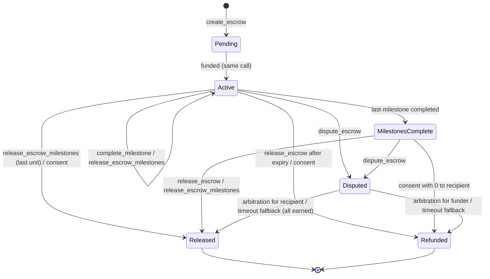

# Escrow Guide

Escrows lock a funder's tokens in the vault and pay them to a recipient as milestones are completed. This guide covers the escrow state machine, partial milestone releases, multisig arbitration and the precedence rules between expiry, disputes and partial releases (Issue #2056).

All function names refer to `contracts/vault/src/lib.rs`. The precedence matrix below is tested cell by cell in `contracts/vault/src/test_escrow_precedence_matrix_2056.rs`.

---

## State machine

| Issue term | `EscrowStatus` |
|---|---|
| Created | `Pending` (only inside `create_escrow`; never stored) |
| Funded | `Active` |
| Milestone* | `Active` with completed / partially released milestones, then `MilestonesComplete` |
| Disputed | `Disputed` |
| Resolved / Expired | `Released` or `Refunded` (terminal) |

Every status change goes through one guard, `EscrowStatus::can_transition_to`. A transition that is not in the diagram fails with `EscrowInvalidTransition`, and every change emits `escrow_state(escrow_id) → (from, to)`.

---

## Partial milestone releases

`release_escrow_milestones(caller, escrow_id)` pays the recipient for completed milestones without waiting for the rest. Caller: funder, recipient or Admin.

- Payable amount: `total × completed% / 100 − released_amount`.
- A milestone is paid at most once. After a partial release the same milestones give 0, and the call fails with `ProposalAlreadyExecuted`.
- When the last unit is paid, the escrow moves to `Released`.
- Refused while `Disputed` (`ConditionsNotMet`) and after expiry (`ProposalExpired`). Use `release_escrow` to settle an expired escrow.
- Emits `escrow_partial_release(escrow_id) → (recipient, amount, released_total)`.

`get_escrow_accounting(escrow_id)` returns where the funds stand:

| Field | Meaning |
|---|---|
| `earned_by_recipient` | `total × completed% / 100` |
| `paid_to_recipient` | Everything transferred to the recipient so far |
| `refunded_to_funder` | Everything returned to the funder so far |
| `locked` | Still held by the vault for this escrow |
| `releasable_now` | What `release_escrow_milestones` would pay right now |

Invariant: `paid_to_recipient + refunded_to_funder + locked == total_amount`.

---

## Arbitration

### Single arbitrator (default)

The arbitrator named in `create_escrow` (with the `DisputeArbitrator` role), or an Admin as a backstop, calls `resolve_escrow_dispute(arbitrator, escrow_id, release_to_recipient)`. All remaining funds go to the side the arbitrator picks. Funds already paid by partial releases are never clawed back.

### Multisig panel

`set_escrow_arbitration_panel(escrow_id, arbitrators, threshold)` installs an M-of-N panel.

- Both the funder **and** the recipient must authorize.
- Only while the escrow is `Active` or `MilestonesComplete` (not during a dispute).
- 1–10 distinct panelists, none of them the funder or recipient.
- `threshold` must be a strict majority (`2 × threshold > N`), so the two outcomes can never both reach it.
- Once a panel is set, `resolve_escrow_dispute` and the generic `resolve_dispute` path no longer settle this escrow.

Panelists call `vote_escrow_arbitration(arbitrator, escrow_id, release_to_recipient)`. Each panelist votes once. When `threshold` votes agree, the escrow is settled at once.

Events: `escrow_panel_set`, `escrow_arb_vote`, then `escrow_dispute_resolved`.

### Timeout fallback

Arbitration is open for `Config.arbitration_timeout_ledgers`, counted from the dispute ledger. After that:

- `resolve_escrow_dispute` and `vote_escrow_arbitration` fail with `EscrowArbitrationClosed`.
- Anyone may call `auto_resolve_escrow(escrow_id)`. It pays the recipient every earned unit that has not been paid yet and refunds only the unearned remainder to the funder.

So a silent, deadlocked or absent arbitrator or panel cannot take earned funds away from the recipient.

---

## Precedence rules

1. **Dispute beats expiry.** A dispute filed before `expires_at` freezes the escrow. `release_escrow` stays blocked even after expiry until arbitration or the timeout fallback settles it.
2. **Expiry beats a late dispute.** Once `expires_at` has passed, `dispute_escrow` fails with `ProposalExpired`. The escrow settles by the expiry rule.
3. **Earned funds survive expiry.** Settling an expired escrow pays completed milestones to the recipient and refunds only the rest.
4. **Partials are final.** Amounts paid by `release_escrow_milestones` are never paid again and never clawed back, by expiry, arbitration or the fallback.
5. **Terminal is terminal.** `Released` and `Refunded` reject every action.

### Matrix

Escrow: 1,000 units, milestone 1 = 40 %, milestone 2 = 60 %. "Paid / refunded" is the split after the action. `—` means the call fails and nothing moves.

**Open states**

| State | Time | `release_escrow` | `release_escrow_milestones` | `dispute_escrow` | `complete_milestone(2)` | resolve / auto-resolve |
|---|---|---|---|---|---|---|
| Funded, nothing done | before expiry | — `ConditionsNotMet` | — `ProposalAlreadyExecuted` | Disputed | Active | — `ProposalNotPending` |
| Funded, nothing done | after expiry | Refunded 0 / 1000 | — `ProposalExpired` | — `ProposalExpired` | — `ProposalExpired` | — `ProposalNotPending` |
| M1 done, unpaid | before expiry | — `ConditionsNotMet` | Active 400 / 0 | Disputed | MilestonesComplete | — `ProposalNotPending` |
| M1 done, unpaid | after expiry | Refunded 400 / 600 | — `ProposalExpired` | — `ProposalExpired` | — `ProposalExpired` | — `ProposalNotPending` |
| M1 paid (partial) | before expiry | — `ConditionsNotMet` | — `ProposalAlreadyExecuted` | Disputed 400 / 0 | MilestonesComplete 400 / 0 | — `ProposalNotPending` |
| M1 paid (partial) | after expiry | Refunded 400 / 600 | — `ProposalExpired` | — `ProposalExpired` | — `ProposalExpired` | — `ProposalNotPending` |
| All done, unpaid | before expiry | Released 1000 / 0 | Released 1000 / 0 | Disputed | — `ProposalNotPending` | — `ProposalNotPending` |
| All done, unpaid | after expiry | Released 1000 / 0 | — `ProposalExpired` | — `ProposalExpired` | — `ProposalNotPending` | — `ProposalNotPending` |

**Disputed states**

| State | Time | release / partial / dispute / complete | Arbitration for recipient | Arbitration for funder | `auto_resolve_escrow` |
|---|---|---|---|---|---|
| M1 paid, disputed | inside window | — blocked | Released 1000 / 0 | Refunded 400 / 600 | — `TimelockNotExpired` |
| M1 paid, disputed | after timeout | — blocked | — `EscrowArbitrationClosed` | — `EscrowArbitrationClosed` | Refunded 400 / 600 |
| All done, disputed just before expiry | after expiry, inside window | — blocked | Released 1000 / 0 | Refunded 0 / 1000 | — `TimelockNotExpired` |
| All done, disputed just before expiry | after timeout | — blocked | — `EscrowArbitrationClosed` | — `EscrowArbitrationClosed` | Released 1000 / 0 |

"Blocked" means: `release_escrow` and `release_escrow_milestones` fail with `ConditionsNotMet`, and `dispute_escrow` / `complete_milestone` fail with `ProposalNotPending`.

**Terminal states** (`Released`, `Refunded`): `release_escrow` and `release_escrow_milestones` fail with `ProposalAlreadyExecuted`. Every other action fails with `ProposalNotPending`.

---

## Other settlement paths

- **Mutual consent** (`consent_release_escrow`, Issue #2142): funder and recipient agree on an amount. No arbitrator is involved.
- **Signer voting** (Issue #1431): escrows with `requires_signer_approval` follow the voting rules in that feature.

## Related

- [DISPUTES.md](./DISPUTES.md): the generic proposal dispute system
- [`../reference/EVENTS.md`](../reference/EVENTS.md)
